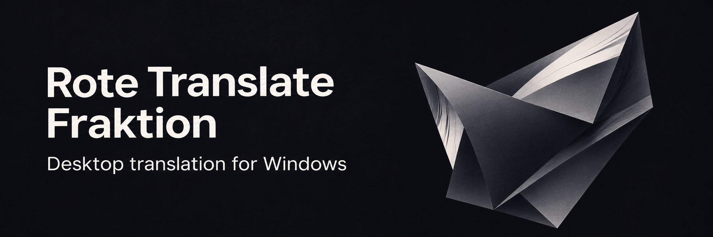
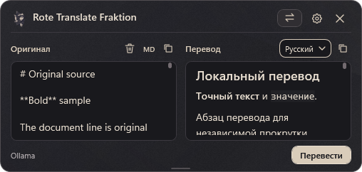
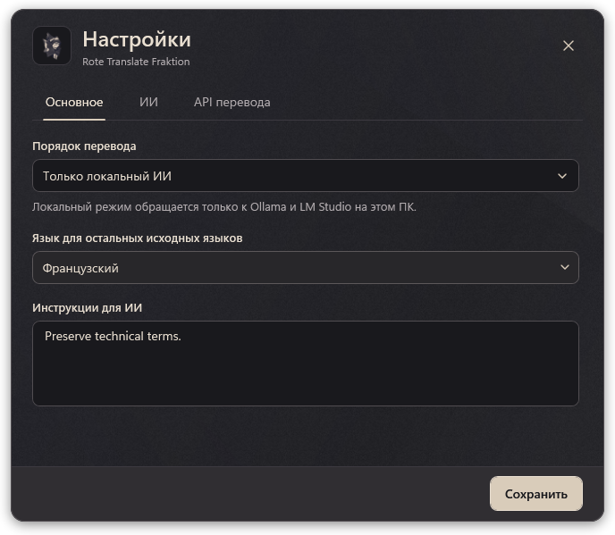
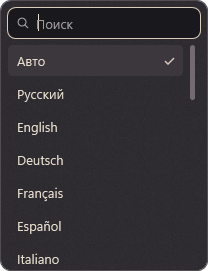

# Rote Translate Fraktion



Select text in another Windows app, then click the floating crystal to translate it. RTF runs in the system tray and works with online translators, AI providers and local models.

[Run](#run) · [Screenshots](#screenshots) · [Providers](#providers) · [Privacy](#data-and-privacy) · [Build](#build-from-source)

## Screenshots

**Translation panel.** Edit the original, preview Markdown and scroll or copy each pane independently.



**Settings.** Configure provider order, the target language and instructions for AI.



<details>
<summary>Searchable language picker</summary>



</details>

## Run

1. Download `RTF-Windows-x64.zip` from **Releases**, extract it and run `RTF.exe`. Install the .NET 10 **Desktop Runtime** if Windows prompts for it.
2. Select text and click the floating crystal. To open an empty panel, briefly hold the middle mouse button.
3. Open settings from the gear in the panel or from the tray. Use **Exit RTF** in the tray menu to stop selection monitoring.

## Providers

Settings control the provider order, target language and optional instructions for AI. The app supports Google Translate and MyMemory without an API key. Configurable services include Yandex Translate, Microsoft Translator, DeepL, Google Cloud and LibreTranslate. AI profiles include OpenRouter, Polza.ai, Ollama, LM Studio and OpenAI-compatible endpoints.

Set provider keys in the app. Local AI mode uses loopback endpoints on this PC. API availability, account quotas and charges depend on the configured provider.

## Data and privacy

RTF uses Windows UI Automation to read selections from the foreground app. The floating crystal can appear without a network request. Selected or typed text is sent to the configured provider when a translation runs. The trigger can be the **Translate** button, automatic translation on opening, or live translation, depending on your settings and selected route. Loading the model catalog contacts the configured AI endpoint.

Provider settings and keys are stored per Windows user in `%LOCALAPPDATA%\Rote Translate Fraktion\translation-settings.dat`, protected with Windows DPAPI. Panel and crystal placement are stored alongside them in `overlay.json`. Selected text and translation results are kept in memory. Contexts such as password fields and apps that do not expose selected text through UI Automation are unavailable for selection-based translation.

## Build from source

Install the .NET 10 SDK on Windows:

```powershell
dotnet build -c Release
```

Run `bin\Release\net10.0-windows\RTF.exe`. The app uses WPF and Markdig. See [THIRD-PARTY-NOTICES.txt](THIRD-PARTY-NOTICES.txt) for Markdig's notice.

## Release packaging

Run `./Pack-Release.ps1` from PowerShell on Windows. It stages an explicit list of project files, builds the staged sources and creates two archives in `release/`. Use the source archive to prepare a clean repository and attach the Windows archive to the GitHub release. The Windows archive is framework-dependent and includes the notices for its bundled dependency.
